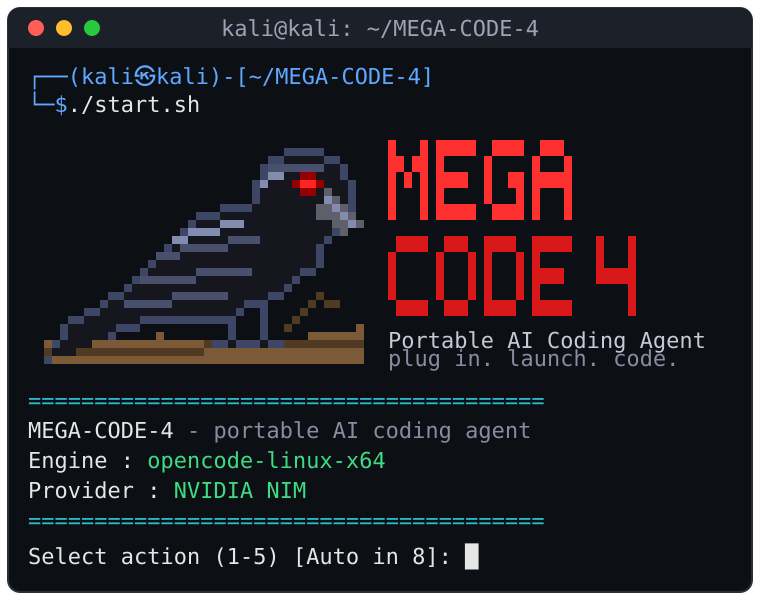

<p align="center">
  
</p>

# MEGA-CODE-4

> Agente de codificação portátil baseado no engine OpenCode, com binários incluídos,
> configuração toda em `data/` e painel local opcional.

**Estado:** executável em Linux, macOS e Windows. O provedor validado é **NVIDIA NIM**;
o endpoint Coarena em `opencode.jsonc` continua sendo apenas um exemplo não validado.

---

## Início rápido

### Linux / macOS

```bash
git clone https://github.com/DeuzimarViana/MEGA-CODE-4.git
cd MEGA-CODE-4
chmod +x start.sh
./start.sh
```

### Windows

```bat
git clone https://github.com/DeuzimarViana/MEGA-CODE-4.git
cd MEGA-CODE-4
START.bat
```

Na primeira execução o launcher pede provedor, chave e modelo. As configurações ficam em
`data/ai_settings.env` e são reutilizadas nas próximas execuções.

---

## Provedores

| # | Provedor | Observação |
|---|---|---|
| 1 | Anthropic Claude | Claude 4 / 3.7 / 3.5 |
| 2 | OpenAI | GPT-4.1, o3/o4, GPT-4o |
| 3 | Google Gemini | Gemini 2.5 / 2.0 |
| 4 | OpenRouter | vários modelos roteados |
| 5 | Groq | Llama, DeepSeek, Qwen |
| 6 | xAI | Grok 3 |
| 7 | **NVIDIA NIM** | validado; chave gratuita em `build.nvidia.com` |
| 8 | Local / Custom | Ollama, LM Studio, qualquer endpoint OpenAI-compatible |

**NVIDIA NIM:** escolha a opção 7, cole a chave `nvapi-...` e use o modelo padrão
`nvidia/nemotron-3-nano-omni-30b-a3b-reasoning`. O launcher verifica a chave com uma
completion de 1 token. O endpoint `/v1/models` é público: listar um modelo não garante
que ele esteja habilitado para sua conta (404) nem que a chave seja válida (403).

**Coarena:** `opencode.jsonc` traz apenas um exemplo (`api.coarena.example`, `Fable-5`).
Confirme URL, modelo e schema com o provedor antes de usar.

Argumentos úteis: `./start.sh --dir /projeto`, `--setup`, `--quick`, `-p "pergunta"`.

---

## Estrutura

```
MEGA-CODE-4/
├── start.sh / START.bat       Launchers (Linux/macOS e Windows)
├── assets/                    Banner do README e arte do corvo (splash)
├── engine/                    Binários OpenCode (5 plataformas)
├── data/                      Config, sessões e cache (portátil, gitignored)
├── tools/
│   ├── build_engine.sh        Rebuild dos binários
│   ├── ENGINE_PATCHES.md      Patches aplicados ao engine
│   ├── change_provider.sh     Trocar provedor/modelo/chave
│   ├── splash.sh / splash.py  Splash do corvo + MEGA CODE 4 (NO_SPLASH=1 desativa)
│   ├── Change_Provider.bat    Versão Windows
│   ├── mcp_router.py          Classificador experimental de prompts
│   ├── secure_env.py          Cifragem opcional de arquivos (AES-GCM)
│   └── start_dashboard.js     Painel HTTP local
├── opencode.jsonc             Config de exemplo (MCPs desativados)
└── docs/                      Status, segurança e prompts
```

---

## Painel local

```bash
node tools/start_dashboard.js
```

Acesse `http://127.0.0.1:3000`. A API `/api/*` exige Bearer token (exibido no terminal).
A antiga rota `/api/token`, que devolvia o token sem autenticação, foi removida.

---

## Segurança

- Chaves são gravadas em texto claro em `data/ai_settings.env` e
  `data/home/.opencode.json`, ambos com permissão `600` e ignorados pelo Git. O
  repositório não contém credenciais.
- `tools/secure_env.py` continua disponível para cifrar/decifrar arquivos manualmente;
  o launcher não exige master password.
- HexStrike e CyberStrike permanecem desativados. `mcp_router.py` apenas sugere nomes
  em JSON: não inicia serviços nem MCPs.
- O `Dockerfile` serve somente os arquivos estáticos do painel; não é uma sandbox.

---

## Engine

Os binários em `engine/` estão prontos para uso. Para reconstruí-los é necessária uma
árvore `opencode-main` com os patches descritos em `tools/ENGINE_PATCHES.md` e Go 1.24+.

## Licença

MIT — Copyright (c) 2026 DEUZIMAR VIANA. O engine empacotado é MIT
(opencode-ai/opencode).
